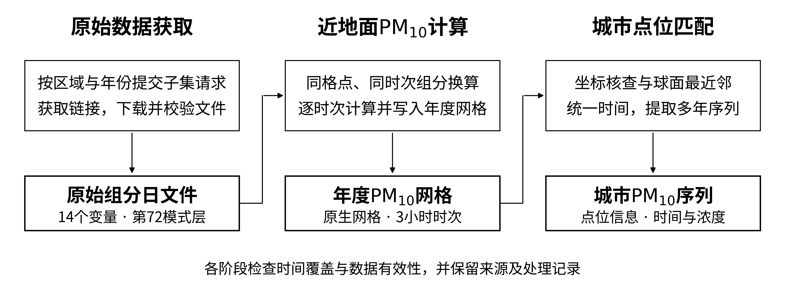

# MERRA-2近地面PM₁₀数据构建与时空匹配方法

方法部分修订稿 V6｜2026年10月21日

本研究以MERRA-2气溶胶再分析资料为基础，构建中国四省区及七个邻国的近地面PM₁₀网格，并用于城市点位的多年序列提取。处理流程包括数据选取、原始资料获取、PM₁₀计算与保存、点位时空匹配四个环节，依次形成原始组分日文件、年度浓度网格和城市时间序列。



## 1 数据来源与研究范围

### 1.1 MERRA-2资料概况

MERRA-2（Modern-Era Retrospective Analysis for Research and Applications, Version 2）是美国国家航空航天局（NASA）全球建模与同化办公室（GMAO）开发的第二代现代时期研究与应用回顾分析资料，由GEOS模式及资料同化系统生成，通过NASA戈达德地球科学数据与信息服务中心（GES DISC）提供访问和分发。该资料结合数值模式与观测约束，提供长期、连续的大气与气溶胶场，适用于多年和跨区域分析[1—3]。

本研究选用M2I3NVAER 5.12.4数据集，对应文件标识inst3_3d_aer_Nv。该数据集提供三维气溶胶组分质量混合比及空气密度，可在相同时间、格点和模式层上获取计算所需变量，从而估算近地面颗粒物浓度。原始下载文件保存的是组分与空气密度，PM₁₀由后续计算得到。再分析资料具有模式网格的空间代表尺度，其估算结果仍需与独立地面观测比较，以评价在研究区域的适用性。

### 1.2 所用数据的基本信息

**表1  M2I3NVAER数据集的基本信息**

| 项目 | 内容 |
| --- | --- |
| 数据集简称与版本 | M2I3NVAER，5.12.4 |
| 文件标识 | inst3_3d_aer_Nv |
| CMR集合编号 | C1276812882-GES_DISC |
| 数据集DOI | 10.5067/LTVB4GPCOTK2 |
| 主要物理量 | 气溶胶组分质量混合比及相关状态变量 |
| 时间覆盖 | 自1980年起，最新可用日期随资料发布更新 |
| 时间分辨率与性质 | 3小时瞬时值，每日8个时次 |
| 每日UTC时次 | 00、03、06、09、12、15、18、21时 |
| 水平网格 | 全球规则经纬度网格，经度间距0.625°、纬度间距0.5° |
| 全球水平格点数 | 576个经度格点×361个纬度格点 |
| 垂直层次 | 共72个模式层，第1层位于顶部，第72层最接近地面 |
| 文件格式与组织 | NetCDF4，通常按日组织，扩展名通常为.nc4 |

本研究选取最接近地面的第72模式层表征近地面状态，其实际高度随大气和地形条件变化。3小时数据为各时次的瞬时场，与小时均值、日均值具有不同的统计含义；水平格点间距以经纬度表示，对应的实际距离随纬度变化。上述特征是后续浓度计算和点位匹配的基本依据[1—3]。

### 1.3 研究区域与时间范围

国内研究区域包括宁夏、新疆、甘肃和内蒙古四省区；国外范围包括蒙古国、哈萨克斯坦、吉尔吉斯斯坦、塔吉克斯坦、阿富汗、巴基斯坦和印度七国。国内采用geoBoundaries的CHN ADM1省级边界，国外采用Natural Earth v5.1.2的1:50m国家级边界，按对应区域多边形请求数据并建立掩膜[4—5]。两套边界的来源、层级和概化程度不同，边界版本与文件校验信息分别保留，以便复现实际处理范围。

本阶段重点获取2015年至NASA最新实际可用日期的数据。资料存在发布滞后，获取截止时间以NASA目录为准，实际完成范围以本地有效文件及运行记录为准。后续与地面观测比较时，采用两类数据共同具有有效记录的时段。

### 1.4 PM₁₀计算所需变量

计算选取第72模式层的14个变量，包括13个气溶胶组分质量混合比和空气密度AIRDENS（表2）。质量混合比表示单位质量空气中所含的组分质量，所列变量与第3章的组分计算方案对应。

**表2  PM₁₀计算所需的14个变量**

| 变量名称 | 物理含义 | 单位 |
| --- | --- | --- |
| AIRDENS | 空气密度 | kg m⁻³ |
| SO4 | 硫酸盐气溶胶质量混合比 | kg kg⁻¹ |
| BCPHOBIC、BCPHILIC | 疏水性、亲水性黑碳质量混合比 | kg kg⁻¹ |
| OCPHOBIC、OCPHILIC | 疏水性、亲水性有机碳质量混合比 | kg kg⁻¹ |
| DU001—DU004 | 第1至第4粒径档沙尘质量混合比 | kg kg⁻¹ |
| SS001—SS004 | 第1至第4粒径档海盐质量混合比 | kg kg⁻¹ |

## 2 原始数据获取与质量控制

### 2.1 区域子集与链接获取

通过Earthdata Login认证后，使用Python调用NASA Harmony服务，按区域和年份提交子集请求，指定研究多边形、表2所列变量和第72模式层。完整历史年覆盖UTC 1月1日00时至12月31日21时，最新年份截至NASA目录实际可用时次。通过预先限定空间范围、变量和层次，减少无关数据的传输。

服务端处理完成后，提取逐日NetCDF文件地址并写入年度TXT清单，同时以JSON保存请求条件、任务编号、状态和到期时间。清单完整性依据任务成功状态及逐日日期覆盖共同判断，检查链接是否覆盖请求时段、有无缺失或重复。

### 2.2 实体文件下载与有效期管理

下载程序读取年度TXT清单，将原始日文件按地区和年份归档。同次运行复用认证信息，并发下载所需文件，已有合格文件继续使用。

Harmony生成的子集结果具有临时保存期限，下载安排以各任务返回的到期时间为准。链接到期后，缺失文件需通过重新获取有效链接补齐；已完整保存并通过校验的本地文件可继续使用。到期时间示例和任务追溯信息见附录。

### 2.3 原始数据完整性检查

下载后先检查文件完整性和NetCDF可读性，再核对日期、日内时次、14个变量、单位、垂直层坐标和经纬度一致性。完整日包含8个时次，完整历史年对应365或366个日文件；最新年份按实际请求范围核对。通过检查后进入计算，并保留校验记录，供中断恢复和复算使用。

## 3 近地面PM₁₀计算与结果保存

### 3.1 组分计算公式

将同一格点、时次和第72模式层的组分质量混合比加权求和，再结合空气密度计算浓度。以S表示加权质量混合比，计算式为：

```equation
S = 1.375×SO4 + BCPHOBIC + BCPHILIC
    + OCPHOBIC + OCPHILIC + DU001 + DU002 + DU003
    + 0.74×DU004 + SS001 + SS002 + SS003 + SS004
PM₁₀ = S × AIRDENS × 10⁹                         （1）
```

S的单位为kg kg⁻¹，与AIRDENS（kg m⁻³）相乘得到kg m⁻³，再乘10⁹转换为μg m⁻³。硫酸盐项系数为1.375，DU004项系数为0.74，其余列出组分的系数为1。该结果包含多类气溶胶贡献，表示所用方案下的总PM₁₀；沙尘贡献需单独提取。公式系数的文献依据仍需核实补全，见文末说明。

### 3.2 逐时次计算

原始日文件按时间顺序逐日处理，读取前核对时间、经纬度及层坐标lev=72。处理时保留原生网格，依据研究多边形对格点中心的覆盖关系建立区域掩膜；每个时次读取14个变量，按式（1）计算PM₁₀并写入结果。逐时次读写将内存需求限制在当前数据切片及缓冲区。

区域外和必要输入缺失的位置保留为缺失值；空气密度出现有限但非正值时停止核查，负PM₁₀单独记录，避免将异常值直接改为零。

### 3.3 年度合并与保存依据

计算过程中，将逐日得到的PM₁₀场按时间顺序写入年度NetCDF4，形成“时间×纬度×经度”数组。年度合并仅改变文件组织方式，保留原始3小时时次，不进行日均或月均处理。国内按四省区联合范围保存年度网格，邻国按国家分别保存，每个国家每年一个文件。

采用NetCDF4可同时保存浓度及坐标、单位、模式层、区域掩膜和公式等元数据，并支持按需读取。按地区和年份组织便于检查、补充和重算；原始日文件保留用于公式调整后的复算，年度网格用于不同城市点位的重复提取。具体存储参数见附录。

### 3.4 计算结果检查

检查年度时间轴的起止时刻、3小时间隔及重复或缺失情况。完整平年应有2920个时次，闰年应有2928个时次，连续片段按实际覆盖范围核对。同时核查坐标、单位和掩膜，统计区域内缺失值、负值及有效值范围。输出文件经重新读取检查后保存为正式结果，时间完整性与数值有效性分别记录。

## 4 城市点位PM₁₀的时空匹配

### 4.1 点位资料与坐标核查

国内目标点位来自城市坐标表city四省.xlsx，共45条记录，包含城市编号、名称、所属省区和经纬度。使用前检查编号重复及位置合理性；当前程序按十进制度读取坐标，未进行坐标基准转换。坐标来源、参考坐标系和代表位置尚待核实，本文统一称为“城市点位”，不预设其为城市中心或空气质量监测站；国外点位扩展采用相同核查要求。

### 4.2 空间匹配

采用球面最近邻方法，在MERRA-2完整原生网格上确定距城市点最近的格点中心，建立固定对应关系，并记录两者的坐标、格点编号及距离。该方法直接保留原生格点值，对应关系可在网格一致的不同年份复用。球面距离采用Haversine公式，表达式见附录。

确定最近格点后，检查本地文件覆盖和数值有效性。边界附近若缺少所需格点，应核查并按需补充，不自动换用区域内更远格点。多个城市对应同一格点的情况予以保留；匹配值代表相应网格尺度，不能反映城市内部的细微差异。

### 4.3 时间对应

依据文件内的时间单位和日历解析模式时刻，以UTC作为统一时间索引，国内同时输出北京时间（UTC+8）。年度网格按UTC年份组织，按当地日期分析时需处理跨日、跨年时刻；国外点位扩展时，根据实际时区转换当地时间。

与地面观测配对前，需明确观测时区、采样时段和统计周期，再统一比较的时间尺度。当前已实现模式3小时时次的提取与时间转换，观测配对窗口及有效样本要求尚待确定。若采用日尺度比较，应统一日界，并明确8个模式瞬时样本形成的日统计属于采样近似。

### 4.4 序列保存与匹配检查

按城市提取对应格点的多年浓度，保存为CSV并按省区归档，同时保留点位与格点对应表。序列包含城市信息、点位和格点坐标、距离、时间、浓度、单位及质量标记，便于核查和追溯。

检查点位齐全性、时间覆盖、重复时刻及缺失和异常值。更新同一年时按UTC时间戳合并，避免重复追加；坐标变化后重新匹配，公式变化则先重算PM₁₀再更新序列。观测比较和精度评价在时空配对规则确定后另行开展。

## 附录 关键技术参数与追溯信息

**表A1  数据组织与主要实现参数**

| 项目 | 当前设置或记录 |
| --- | --- |
| 任务与链接 | 按国家、年代、年份归档JSON与TXT；记录请求条件、任务编号、状态、清单写出时间及结果到期时间 |
| 国内年度网格 | merra_data/pm10/年份_pm10.nc4；原始日文件保存在merra_data/raw/年份/ |
| 邻国年度网格 | merra_data_neighbors/pm10/英文国家/年份_pm10.nc4；原始文件按英文国家和年份归档 |
| 浓度精度 | float64中间计算，PM10以float32保存，浓度单位为μg m⁻³ |
| 分块与压缩 | 时间块8；纬度块min(32, 纬度数)，经度块min(64, 经度数)；zlib等级2，shuffle，Fletcher32 |
| 国内城市序列 | 按省区保存城市_PM10.csv，另存city_grid_mapping.csv及配置记录 |
| 结果追溯 | 保留边界版本、公式、输入文件校验、时次覆盖、异常统计及输出校验 |

zlib对已存储数值进行无损压缩，float64转float32本身存在舍入。任务记录和链接用于来源追溯，原始组分支持复算，年度网格支持不同点位重复提取，城市序列用于后续统计与观测比较。

有效期示例：巴基斯坦2026年任务记录的到期时间为2026-11-20 05:34:09.037 UTC，对应北京时间当日13:34:09.037。该日期仅用于该次临时结果的下载安排，其他任务读取各自记录。

球面距离计算：设点位p与格点g的纬度、经度分别为φ、λ，均以弧度计算，R取6371.0088 km，则：

```equation
a = sin²[(φg−φp)/2] + cosφp cosφg sin²[(λg−λp)/2]
d(p,g) = 2R arcsin(√a)，  g* = argmin_g d(p,g)       （2）
```

其中g*为最近格点，距离随点位映射保留，用于检查空间代表性。

## 参考资料

[1] Global Modeling and Assimilation Office (GMAO). MERRA-2 inst3_3d_aer_Nv: 3d, 3-Hourly, Instantaneous, Model-Level, Assimilation, Aerosol Mixing Ratio V5.12.4 (M2I3NVAER)[DS]. NASA GES DISC, 2015. DOI: 10.5067/LTVB4GPCOTK2.

[2] Gelaro R, McCarty W, Suárez M J, et al. The Modern-Era Retrospective Analysis for Research and Applications, Version 2 (MERRA-2)[J]. Journal of Climate, 2017, 30(14): 5419–5454. DOI: 10.1175/JCLI-D-16-0758.1.

[3] Randles C A, da Silva A M, Buchard V, et al. The MERRA-2 Aerosol Reanalysis, 1980 Onward. Part I: System Description and Data Assimilation Evaluation[J]. Journal of Climate, 2017, 30(17): 6823–6850. DOI: 10.1175/JCLI-D-16-0609.1.

[4] geoBoundaries. CHN ADM1, gbOpen[DS]. 采用提交5c25134028196d43ce97b5071934fd0cfc92f09f下的releaseData/gbOpen/CHN/ADM1/geoBoundaries-CHN-ADM1.geojson。

[5] Natural Earth. Admin 0 – Countries, 1:50m, v5.1.2[DS]. 采用nvkelso/natural-earth-vector仓库v5.1.2标签下的geojson/ne_50m_admin_0_countries.geojson。

公式依据待补说明：当前组分系数沿用前期提供的学位论文第10页。正式定稿前，需核实作者、题名、年份及系数的原始文献依据，并补入参考文献；本稿将其作为采用中的估算方案记录。

数据集入口：https://doi.org/10.5067/LTVB4GPCOTK2；NASA数据页面：https://disc.gsfc.nasa.gov/datacollection/M2I3NVAER_5.12.4.html。
